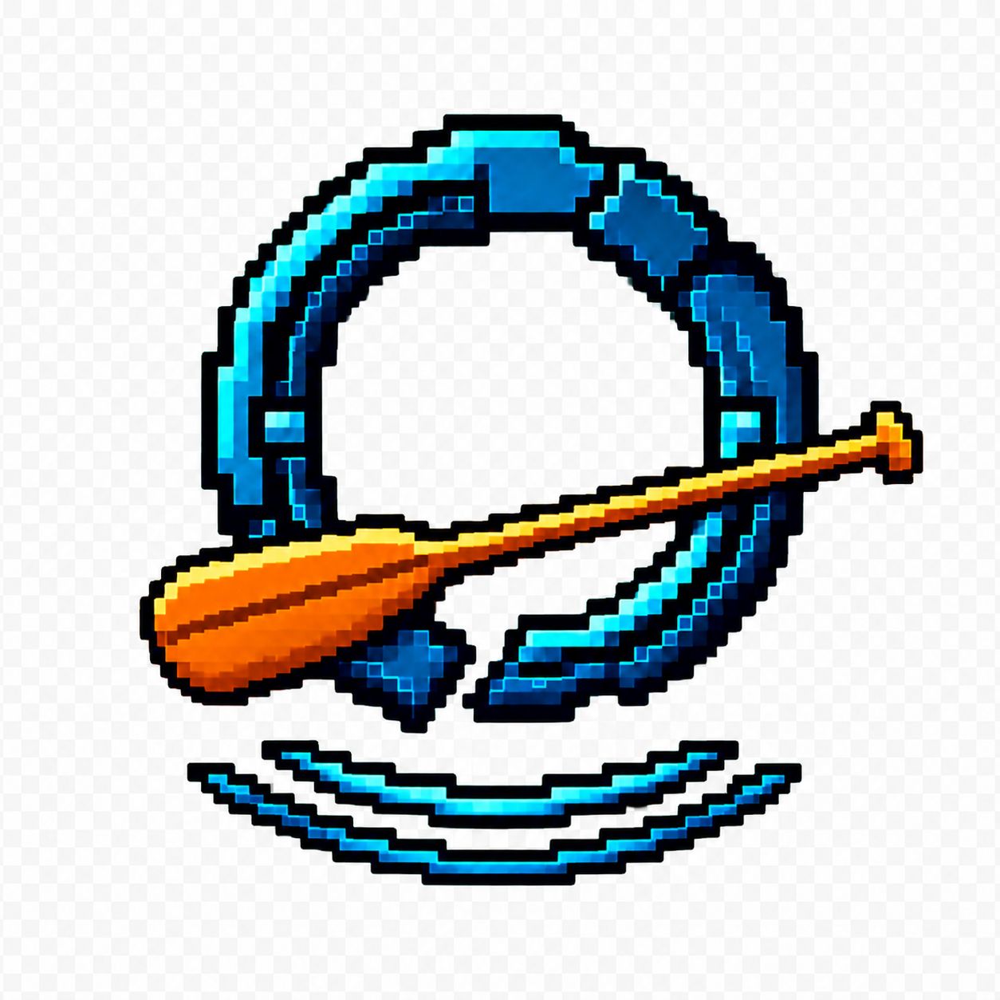
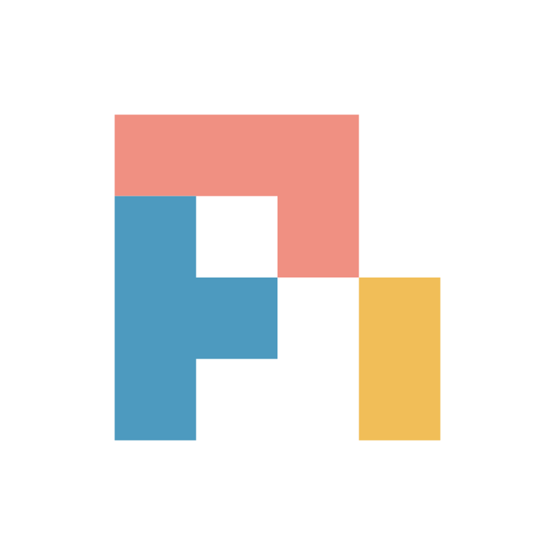

# OAR - *programming interface for all agent harnesses* [](https://raft.build)

<div align="center">
  
</div>

OAR (**O**pen **A**gent **R**untime) is a provider-independent programming interface for coding-agent runtimes: a solid foundation for building agent workspaces and other applications.

**Delete harness logic and focus on outcomes and UX.**

## Supported runtimes

<table>
  <tr>
    <td align="center" width="112">
      <a href="docs/runtimes/antigravity.md">
        <br>
        Antigravity
      </a>
    </td>
    <td align="center" width="112">
      <a href="docs/runtimes/claude.md">
        <picture>
          <source media="(prefers-color-scheme: dark)" srcset="packages/oar/assets/brands/claude.svg">
          
        </picture><br>
        Claude Code
      </a>
    </td>
    <td align="center" width="112">
      <a href="docs/runtimes/codex.md">
        <picture>
          <source media="(prefers-color-scheme: dark)" srcset="packages/oar/assets/brands/codex-on-dark.svg">
          
        </picture><br>
        Codex
      </a>
    </td>
    <td align="center" width="112">
      <a href="docs/runtimes/codebuddy.md">
        <picture>
          <source media="(prefers-color-scheme: dark)" srcset="packages/oar/assets/brands/codebuddy-on-dark.svg">
          
        </picture><br>
        CodeBuddy Code
      </a>
    </td>
    <td align="center" width="112">
      <a href="docs/runtimes/cursor.md">
        <picture>
          <source media="(prefers-color-scheme: dark)" srcset="packages/oar/assets/brands/cursor-on-dark.svg">
          
        </picture><br>
        Cursor
      </a>
    </td>
    <td align="center" width="112">
      <a href="docs/runtimes/grok.md">
        <picture>
          <source media="(prefers-color-scheme: dark)" srcset="packages/oar/assets/brands/grok-on-dark.svg">
          
        </picture><br>
        Grok Build
      </a>
    </td>
  </tr>
  <tr>
    <td align="center" width="112">
      <a href="docs/runtimes/kimi.md">
        <picture>
          <source media="(prefers-color-scheme: dark)" srcset="packages/oar/assets/brands/kimi-on-dark.svg">
          
        </picture><br>
        Kimi Code
      </a>
    </td>
    <td align="center" width="112">
      <a href="docs/runtimes/opencode.md">
        <picture>
          <source media="(prefers-color-scheme: dark)" srcset="packages/oar/assets/brands/opencode-on-dark.svg">
          
        </picture><br>
        OpenCode
      </a>
    </td>
    <td align="center" width="112">
      <a href="docs/runtimes/pi.md">
        <picture>
          <source media="(prefers-color-scheme: dark)" srcset="packages/oar/assets/brands/pi-on-dark.svg">
          
        </picture><br>
        Pi
      </a>
    </td>
    <td align="center" width="112">
      <a href="docs/runtimes/qwen.md">
        <picture>
          <source media="(prefers-color-scheme: dark)" srcset="packages/oar/assets/brands/qwen-on-dark.svg">
          
        </picture><br>
        Qwen Code
      </a>
    </td>
    <td align="center" width="112">
      <a href="docs/runtimes/qoder.md">
        <picture>
          <source media="(prefers-color-scheme: dark)" srcset="packages/oar/assets/brands/qoder-on-dark.svg">
          
        </picture><br>
        Qoder
      </a>
    </td>
    <td align="center" width="112">
      <a href="docs/runtimes/dsh.md">
        <picture>
          <source media="(prefers-color-scheme: dark)" srcset="packages/oar/assets/brands/dsh-on-dark.svg">
          
        </picture><br>
        DeepSeek Harness
      </a>
    </td>
  </tr>
</table>

[Pi Durable](docs/runtimes/pi-durable.md) also runs through a host-owned Harness,
including in a browser ([demo](apps/pi-durable/README.md)).

## Library

One API drives every runtime: swap `"claude"` for `"codex"`, `"grok"` or
`"pi"` (with a model it has) and the code stays the same. An option a runtime cannot honor is refused
before anything opens, never silently dropped.

```ts
import { defaultRuntimes, promptAndWait } from "@botiverse/oar";

const claude = defaultRuntimes.require("claude");
const installation = await claude.installation?.();
if (installation?.kind !== "available") throw new Error("claude is not installed");

const session = await claude.session(installation, { cwd: process.cwd(), model: "sonnet" });

session.events((event) => {
  // Every event says which agent it came from: [] is the root.
  if (event.kind === "text_delta" && event.agentPath.length === 0) process.stdout.write(event.text);
  if (event.kind === "tool_call_started") console.log(event.tool);
});

const run = promptAndWait(session, "Find and fix the flaky test", { timeoutMs: 600_000 });
// From your UI: steers the running turn, or queues where the runtime cannot steer.
await session.deliver("Leave the snapshots alone.");
console.log(await run);
await session.dispose();

// Later, even from another process: the same conversation.
const resumed = await claude.session(installation, { cwd: process.cwd(), resume: session.id });
```

A session gives you:

- **Every fact, attributed.** One event per fact with `seq` and `agentPath`;
  `rawEvents()` keeps every native payload verbatim
  ([record stream](docs/spec/record-stream.md)).
- **Control with honest answers.** `prompt`, `steer`, `queue`, `withdraw` and
  `abort` answer accepted or rejected with a typed code
  ([conversation](docs/spec/conversation.md)). Runtimes with native compaction
  also offer `compact` ([contract](docs/spec/manual-compaction.md)).
- **Your own tools and subagents.** `serveMcpTools` attaches host tools to any
  runtime; `@botiverse/oar/agents` hands work to other runtimes
  ([host tools](docs/spec/runtime-matrix.md#host-served-tools)).
- **Views and tests.** `@botiverse/oar/observe` folds records for a UI, in a
  browser too; `@botiverse/oar/testing` is a scripted runtime with no binary or
  login.

What differs by runtime is declared on the `Runtime`, not guessed
([matrix](docs/spec/runtime-matrix.md)). Entry points and setup:
[package README](packages/oar/README.md).

## Without a session

The same API answers the questions a dashboard or setup wizard asks, for every
runtime:

```ts
for (const runtime of defaultRuntimes.list()) {
  const installation = await runtime.installation?.();
  if (installation?.kind === "available") {
    console.log(runtime.id, await runtime.listModels?.(installation));
  }
}
```

- **[Orientation](docs/spec/orientation.md):** one call for what is installed and usable.
- **[Install](docs/spec/install.md) and [update](docs/spec/update.md):** through the vendor's own installer and updater.
- **[Login](docs/spec/login.md):** through the runtime's own login, without a terminal. OAR never handles the tokens.
- **[Account usage](docs/spec/account-usage.md):** plan and quota windows, and Codex limit resets.
- **Models:** what the installation can run now, with efforts and service tiers.
- **[Inventories](docs/spec/inventory.md):** configured skills, commands, MCP servers and tools.
- **[Setup forms](docs/spec/config-form.md):** settings as data a UI renders.

## CLI

```bash
npx @botiverse/oar-cli list
oar run claude "What does this repo do?" --record run.jsonl
```

Every command: [packages/cli](packages/cli/README.md) (published as `@botiverse/oar-cli`).

## Docs

- [Design](docs/design/README.md): why oar exists, its decisions and what comes next.
- [Spec](docs/spec/README.md): the record stream and every contract built on it.
- [Runtimes](docs/runtimes/README.md): what each runtime says natively and how oar maps it.
- [Prior art](docs/prior-arts/README.md): related projects compared feature by feature.
- [Development](docs/development.md): working in this repo.

ESM-only, Node entry requires Node.js 24+; the browser entry needs a modern browser
with Web Crypto. Apache-2.0.
