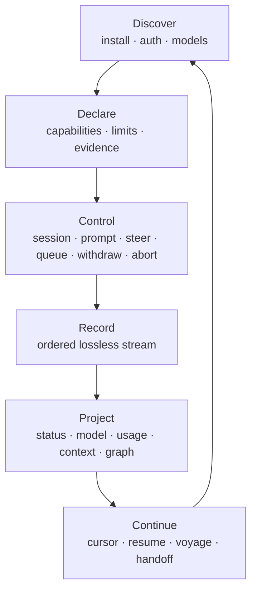

# OAR as an agent-facing system

OAR is a library and contract layer for embedding agent runtimes, plus an
evidence substrate that makes their behavior inspectable. Runtime adapters are
replaceable edges of one coherent system. A host or application supplies the
control-plane policy around this layer.

An agent using OAR should always be able to answer: what is available, what is
true, what can I do, what happened, and how do I continue without guessing?
Those questions define the seams. Adapters supply native facts and controls;
contracts preserve meaning; observation helpers derive read models; hosts own
policy, storage, scheduling, and presentation.

## The six linked layers

- **Discover** is bounded: installation probing does not perform account I/O,
  and model/usage reads expose their authentication and resource cost.
- **Declare** is the decision surface. What a runtime or session can do is in
  its type: an operation it lacks is an absent member, an option it cannot
  honor is a typed `UnsupportedOptionError`, and a declaration exists only
  where a host must decide before acting ([capabilities](capabilities.md)).
  Nothing promises more than the interface proves.
- **Control** is explicit. Every action has a typed acceptance result and a
  known landing point; a rejection leaves the input with its caller.
- **Record** is the evidence boundary. One ordered stream preserves native
  payloads, attribution, and control obligations.
- **Project** is disposable read-model code. The default read model is the
  flat `Event` stream (`Session.events()`), a projection over the record
  stream that hides record kinds and native frames without removing them:
  `rawEvents()` keeps every native payload reachable underneath. Status,
  liveness, usage, and UI views are further folds over records and can be
  rebuilt without changing history.
- **Continue** is how work compounds: cursors, native resume identities,
  voyage logs, experiments, tests, and handoffs prevent rediscovery.

The arrows describe information dependencies, not a mandatory call sequence.
A host may discover once and run many sessions, subscribe before prompting, or
rebuild projections from a voyage log. Projections never become a second
source of truth, and adapters never depend on a host UI or storage engine.

## The agent operating loop

The ergonomic unit is a bounded control loop, not a single prompt:

1. **Orient:** read only the installation, model, capability, session, and
   cursor state needed for the decision. Prefer a narrow query to starting a
   session just to find out.
2. **Choose:** select a runtime and control using capability, evidence,
   latency, quota, and recovery policy. Keep the choice visible to the host.
3. **Act:** issue one explicit control action and inspect its typed response
   before assuming it landed.
4. **Observe:** consume the ordered stream; keep the native record for any
   decision that matters.
5. **Verify:** check the runtime's own completion, error, usage, and liveness
   facts. Silence is unknown, never success.
6. **Checkpoint:** persist a cursor or voyage artifact with runtime identity,
   model, capability decision, and evidence needed to replay the step.
7. **Handoff:** leave the next owner a session identity, cursor, and actionable
   next step, including any irrecoverable gap.

The loop is restartable. A crashed worker can replay and continue; another
worker can inspect the same evidence; a human can intervene at a control
boundary without reconstructing hidden adapter state.

Orientation follows this cost boundary: local discovery uses only evidenced
local readers; account and catalog effects require a deeper explicit read.
The [orientation contract](../spec/orientation.md) composes native readers,
while its readiness projection leaves selection and freshness policy to hosts.

## Agent ergonomics are invariants

- **Discoverability:** public names, docs, records, and errors answer what to
  do next. Typed `unsupported` includes a reason.
- **Inspectability:** meaningful state is queryable or reconstructible from
  records. Hidden mutable flags are an adapter smell.
- **Actionability:** outcomes say whether input was accepted, whether retry is
  sensible, and who owns the next decision. Never infer this from silence.
- **Composability:** shared mechanisms carry no runtime identity; runtime
  policy stays local; projections consume contracts only.
- **Boundedness:** controls are bounded and explicit; rejected input remains
  caller-owned; disposal and handoff are observable. A control may race with
  runtime progress and is not implicitly reversible.
- **Resource awareness:** cheap probes precede expensive runs; real logins and
  model calls are deliberate; deadlines, cancellation, and quota remain
  visible.
- **Native reachability:** abstraction removes mechanism differences, not
  information. Native payloads remain reachable and vendor extensions stay
  behind explicit capability boundaries.

## Accumulating value

Leave a reusable artifact at every seam: a run leaves records; a probe leaves a
script and conclusion; a design decision leaves rationale; a handoff leaves
identity, cursor, and next action. Projections and caches remain disposable,
so the source evidence can always rebuild them.

## System quality axes

Three host-facing qualities guide additions to every layer:

- **Developer experience:** a small, typed surface should be enough to inspect
  and drive a runtime; examples, errors, and tests should reveal the next
  operation without requiring vendor internals.
- **Extensibility:** a new runtime, transport, or projection should attach at
  one explicit seam and preserve existing contracts. Runtime-specific policy
  belongs in a leaf adapter; shared layers grow only from boundaries shown by
  more than one runtime.
- **Debuggability:** every surprising result should be traceable from the
  control request through ordered native records, projection inputs, and the
  relevant experiment or test. A host may add richer diagnostics, but it must
  not replace source evidence with a derived summary.

## Ownership and boundaries

OAR owns adapter observation and the public meaning of records. The host owns
scheduling, policy, persistence, multi-controller arbitration, and human
presentation. A consumer may cache projections, but must be able to rebuild
them from the stream. A runtime may expose stronger native behavior than OAR
maps; that is evidence-backed follow-up, never permission to infer support.

## Placement

A session and the process that runs it are separate layers. An agent that
executes code on the user's machine runs in a runtime process apart from the
host: only a process boundary gives a stop that does not depend on the agent's
cooperation, fault and memory isolation from the host, and a dependency tree
apart from the host's. CLI runtimes have this natively. Where a runtime's
primary interface is an in-process SDK, OAR drives the vendor's own
out-of-process interface as an explicit placement (Pi's RPC mode); it does not
build its own process wrapper around an SDK. In-process remains an explicit
choice for what only it provides: host functions injected as tools, browser
hosts, and engines whose storage the host owns (pi-durable). Whether sessions
share a runtime process is a further choice, below. The Session members do
not change with placement; what differs is declared like any other capability
difference. A host shipped as a single executable supplies the command that
starts the runtime process, and OAR checks that the started runtime is the
version it pins.

### Shared runtime processes

Some runtimes' own servers hold many sessions in one process: the Codex
app-server, and ACP agents that accept concurrent `session/new` on one
connection. Sharing that runtime process (with its children) saves memory.
At ten sessions after one turn, Codex took about 1,974 MiB of RSS as ten
app-servers (each including about 50 MiB of npm launcher) and 218 MiB as ten
threads on one; the ACP agents measured used between about half
(Antigravity) and an eighth (Kimi) of their isolated RSS, and one OpenCode
version used more CPU shared than isolated. These are Linux measurements only
([2026-10-28 report](../../experiments/runtime-resources-2026-10-28.md)).

The default follows the runtime: once a runtime version meets the evidence
gate in rule 5, its sessions share a process by default. Sharing gives up
two guarantees that only a process per session provides: a stop that does
not depend on the runtime, and a crash or leak confined to one session. A
host that needs them chooses isolated placement on the runtime instance it
opens sessions from. Sessions share a process (the pool) only when they come
from the same runtime instance; the default runtime instances are module
level, so every session opened from one of them in the host process joins
the same pool. The runtime instance declares the host's request: automatic,
shared or isolated. The actual placement belongs to each opened session,
after the adapter has checked its installation's version and platform. An
automatic request falls back to isolation when evidence is missing; an
explicit shared request is refused then. In-process SDK execution is a
separate fact and cannot silently satisfy either explicit process placement.
The [record-stream contract](../spec/record-stream.md#placement-and-release)
defines the request, observation and release records.

The Session members stay the same in both placements. What `dispose`, the
abort fallback and `resources()` guarantee differs, and is declared: in a
shared process, a session can end without its process exiting, the abort
fallback releases the session instead of killing the process (rule 2), and
`resources()` reports the whole shared process, saying so.

Sharing follows five rules:

1. **Share only when process-level settings match.** Sessions join one
   process only when everything the runtime reads at process level is
   identical: executable and arguments, environment overlay, home and
   configuration directories. What the protocol carries per session (cwd, model, effort,
   instructions, MCP servers) does not split the pool, where evidence shows
   it stays per session.
2. **The fallback releases the session; it does not kill.** `abort` stays
   the runtime's own interrupt. If the turn has not ended within the fallback
   interval, OAR accepts the pending abort and records a release for that
   session: OAR's own fact, recorded like an exit, saying OAR stopped
   controlling the session while its process keeps running for peers.
   Disposal in a shared process records the same release (or an exit, if the
   session was the last). Folds read a release after that turn's accepted
   abort or its dispose request as the turn's end, `aborted`, as they read an
   exit in isolated placement; later controls are refused as after an exit.
   No native outcome is invented, and the record says the native turn may
   still be running. Frames the runtime sends for the session afterwards are
   still recorded. Per-session cleanup (rule 3) runs at the release and again
   at dispose; a command the turn starts after the last cleanup is not
   stopped, and the record says so.
3. **Ending a session stops only what it started.** Disposal uses
   the runtime's own per-session cleanup, addressed by the runtime's own ids,
   never by OS process tree (which would reach peers): terminating each of
   the session's background commands (Codex
   `thread/backgroundTerminals/list` and `terminate`), or releasing the
   terminals OAR hosts for that ACP session. A cleanup that fails is
   recorded and never reported as stopped. Disposal also releases the native
   session where the runtime can; where it cannot (Codex
   `thread/unsubscribe` leaves the thread loaded), the runtime declares that
   the shared process keeps it, including any refusal to resume it in
   another process meanwhile. Cleanup never changes the user's persisted
   state: Codex `thread/archive` was observed to stop a thread's commands,
   but a resume would then need unarchive, which OAR never does, so it is not
   used.
   Where no per-session cleanup exists or it is unverified, the runtime does
   not share.
4. **One fault, every session.** If the shared process exits, every session
   still attached to it ends, each with its own exit record. A session whose
   dispose already released its lease has unsubscribed and receives no later exit. OAR does not restart or replace
   a shared process while sessions run in it; the process ends when its last
   session is disposed.
5. **Shared only with evidence.** A runtime version shares only after these
   have been observed on it, on each platform where sharing is offered:
   concurrent sessions; isolation of messages, cwd, MCP servers and child
   session attribution on the shared connection; cancellation that leaves
   peers running; per-session cleanup; resuming a session already loaded in
   the process; and the process's failure cases (exit with sessions running,
   close and resume at the same time); and lower memory without higher CPU
   than isolated, measured on that version and platform. Until then it runs one process per
   session, and an explicit request for shared placement is refused with a
   typed reason. The exact versions and platforms that meet this gate are
   recorded in the [evidence index](../../experiments/sharing/README.md)
   (currently the 2026-10-30 report). Until adapters enable sharing, all native
   sessions still run in isolation. Claude, Qwen and Pi RPC
   run one session per native process and are always isolated. Qoder 1.1.80
   and earlier are also isolated. From 1.1.81, Qoder's native SDK daemon can
   run multiple sessions ([probe](../../experiments/qoder-native/daemon-2026-10-29.md));
   admission still requires evidence for every part of this rule.
